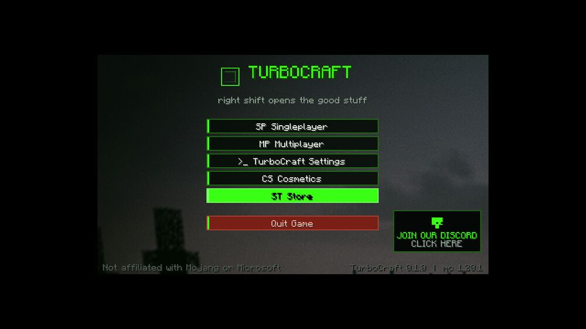

# TurboCraft-Client

Minecraft: Java Edition ke liye **TurboCraft Client** — Android-first client mod (Fabric),
jo TurboCraft Launcher ke saath aur Pojav / Amethyst / Zalith jaise launchers me bhi chalta hai.

> Not affiliated with Mojang or Microsoft. Is repo me Minecraft ke game files nahi hain.

## Repo me kya hai

```
docs/
├── android-java-edition-engine-notes.md   # Android pe Java Edition kaise chalta hai (Pojav/Amethyst source study)
├── client-strategy.md                     # launcher vs client, roadmap, licensing, phone-only dev workflow
└── testing.md                             # CI + phone test checklist, crash troubleshooting

client/                                    # Fabric mod (Minecraft 1.20.1)
├── src/main/java/com/turbocraft/client/
├── src/main/resources/fabric.mod.json
├── mods-manifest.json                     # launcher auto-install ke liye recommended mods
└── build.gradle

.github/workflows/build.yml                # push pe jar build + artifact + rolling release
.github/workflows/smoke.yml                # headless MC boot test (mixin/startup crash detector)
```

## Status

| Workflow | State |
|---|---|
| Build (jar + resources verified) | ✅ green |
| Smoke test (MC 1.20.1 boot with mod, 0 mixin errors) | ✅ green |

## Features (v0.1.0)

**Custom title screen** — FastClient/Lunar-style layout in **neon green on black**: full-bleed background
art with dark overlay, logo mark + wordmark, centred button column (Singleplayer / Multiplayer /
TurboCraft Settings / **Store** / Quit), a clickable **Discord card** bottom-right, and a version footer.
Fully responsive — the column, card and footer re-flow instead of overlapping at phone Gui scales, and
the card hides itself rather than sitting on top of a button.



**In-game**
- HUD: FPS, CPS (L|R), coordinates, ping, keystrokes (WASD + space)
- Frame-time graph + **1% low** (smoothness, not just a big FPS number)
- Right Shift menu with toggles, auto-saved to `config/turbocraft.json`
- HUD editor: drag to move, ± to scale (0.5x–2x)
- Client-side only — safe on vanilla servers (Hypixel, etc.)

## Customising

`config/turbocraft.json`:
```json
{
  "customTitleScreen": true,
  "discordUrl": "https://discord.gg/turbocraft",
  "hudX": 4, "hudY": 4, "hudScale": 1.0,
  "showGraph": true
}
```

## Build

Har push pe GitHub Actions jar build karta hai:
**Actions → Build TurboCraft Client → Artifacts → `turbocraft-client-jar`**,
ya **Releases → latest-build**.

Local:
```bash
cd client && ./gradlew build
```

## Quick start (phone)

1. Launcher me **Minecraft 1.20.1 + Fabric** profile banao.
2. `mods/` me daalo: `turbocraft-client-0.1.0.jar` + **Fabric API** (+ Sodium recommended).
3. Java **17**, RAM ~2–2.5 GB, renderer MobileGlues/Zink (Snapdragon) ya GL4ES (Mali).
4. Game me **Right Shift** → TurboCraft menu.

Details: [`docs/client-strategy.md`](docs/client-strategy.md),
[`docs/testing.md`](docs/testing.md),
[`client/README.md`](client/README.md).

## License

Mod code: MIT. (PojavLauncher / Amethyst LGPL-3.0 code is repo me include nahi hai — unhe fork karne
ka plan ho to `docs/client-strategy.md` ka licensing section padho.)
